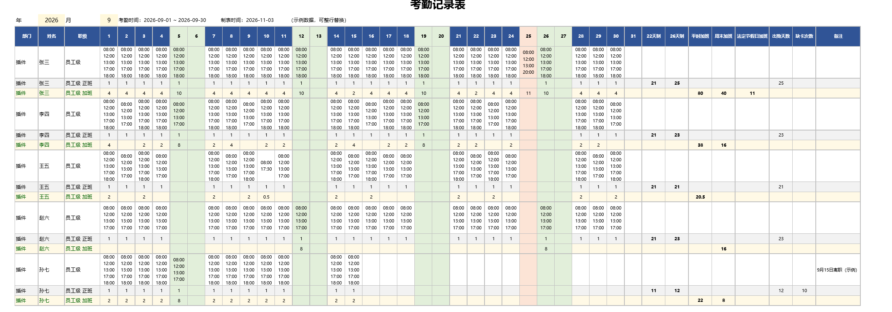

# 考勤工时自动计算表

按需求中的考勤记录表样板制作：把每天的原始打卡时间粘进日期格，表格自动统计正班、平时加班、周末加班和法定节假日加班，并按劳动法口径区分 1.5 倍 / 2 倍 / 3 倍。



## 下载

[工时自动计算表.xlsx](工时自动计算表.xlsx)

工作簿内含 4 个工作表：

| 工作表 | 用途 |
| --- | --- |
| 考勤记录表 | 主表：原始打卡、正班/加班行、22天制/26天制、平时/周末/法定节假日加班汇总 |
| 使用说明 | 填写步骤、计算规则、劳动法依据、限制 |
| 设置 | 标准工时、加班取整单位、两次打卡日午休扣除等参数 |
| 节假日设置 | 法定节假日、休息日、调休上班日维护 |

## 使用方法

1. 下载 `工时自动计算表.xlsx`，用 WPS 或 Excel 打开。
2. 在“设置”确认标准工时（默认 8 小时/天）、加班取整单位（默认 0.5 小时）等参数。
3. 在“节假日设置”核对当月法定节假日、休息日和调休上班日。
4. 在“考勤记录表”B2、D2 填年份和月份。
5. 把每位员工每天的原始打卡时间粘进对应日期格：一次打卡一行（Alt+Enter 换行），按时间先后排列，格式 `hh:mm`。
6. 正班、加班、22天制/26天制、平时加班、周末加班、法定节假日加班自动重算。

> 示例数据为虚构，可整行替换；需要增加员工时，复制一组 3 行（记录/正班/加班）插入到下方。

## 计算规则

- **有效工时**：按“上班—下班”成对累加，午休/晚餐休息间隔不计；一天只有 2 次打卡时按“两次打卡日午休扣除”扣减。
- **工作日**：8 小时以内计正班；超过 8 小时的部分计平时加班。
- **休息日**（周六日/休息日）：全部有效工时计周末加班，可安排补休。
- **法定节假日**：全部有效工时计法定节假日加班，不能以补休替代。
- **取整**：默认 0.5 小时向下取整，可在“设置”改为 1 小时。
- **正班天数**：有效工时 ≥6 小时记 1 天，≥2 小时记 0.5 天；22天制统计周一至周五，26天制再计入周六。
- **缺卡次数**：工作日打卡次数为奇数或未打卡的天数，仅作核对提示。

## 劳动法依据

- 《劳动法》第 36 条：每日不超过 8 小时、平均每周不超过 44 小时；国务院规定职工每日工作 8 小时、每周工作 40 小时。
- 《劳动法》第 41 条：延长工作时间一般每日不超过 1 小时；特殊原因每日不超过 3 小时，每月不超过 36 小时。
- 《劳动法》第 44 条：延长工作时间支付不低于 150% 工资；休息日工作又不能补休的支付不低于 200%；法定休假日工作支付不低于 300%。
- 劳社部发〔2008〕3 号：月计薪天数 21.75 天，日工资=月工资÷21.75，小时工资=日工资÷8。
- 加班工资=小时工资×倍数×加班小时数；本表只计算小时数，不自动计算工资金额。

## 使用限制

- 每个日期格最多识别 6 次打卡（3 组上下班）；超过 6 次的只计算前 3 组。
- 跨天夜班不会自动合并到前一天，请按实际班次拆分为两天记录。
- 公式使用 `TEXTSPLIT` / `LET`，需要 WPS 2021 及以上，或 Microsoft 365 / Excel 2021 及以上。
- 法定节假日和调休上班日需按国务院办公厅当年通知维护；表中已列 2026 年中秋、国庆、元旦。
- 样板右侧的迟到分数、缺卡扣分、请假扣分、绩效扣分等属于公司薪酬制度项，未纳入本表自动计算；本表聚焦工时与加班分类。
- 示例姓名为虚构，示例打卡数据仅用于演示。

## 文件结构

```text
工时自动计算表.xlsx
docs/考勤记录表-预览.png
README.md
```

Super-agent was here.
